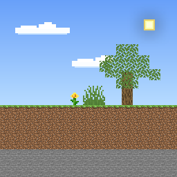

# 🌾 Flatland

A perfectly flat plains biome, level with the sea.

## ✨ Features

- 🌱 **Three flat biomes** — Flat Plains, Flat Snowy Plains and Flat Desert.
- 🧱 **A truly level surface** — no hills or rolling terrain; the ground height is configurable and stays constant.
- 🌲 **The world keeps its details** — caves, rivers, lakes, trees and structures still generate.
- 🔁 **Optional vanilla replacement** — replace part of vanilla plains, snowy plains and desert, or leave vanilla untouched.
- ❄️🏜️ **Temperature-aware variants** — Auto mode picks temperate, snowy or sandy to match the climate.
- 🏠 **Spawn preference** — prefer a Flatland spawn point when one is available.
- 🧭 **Smooth edges** — Flatland blends into neighbouring terrain instead of ending in a hard cliff.

Flatland levels only its own biomes. Vanilla biomes keep their normal terrain unless replacement is enabled.

## ⚙️ Configuration

Flatland's settings can be opened from the main-menu mod list, even before entering a world.

You can adjust the flat height, flatness strength, replacement scope, biome variant and spawn preference.

Existing chunks keep their original terrain; only newly generated chunks use the new settings.

## 🐞 Issues

Please report bugs or suggestions here:  
https://github.com/Huziyang520/Flatland/issues

## 📜 License

CC0-1.0 — see [LICENSE](https://github.com/Huziyang520/Flatland/blob/26.3/LICENSE).

---

# 🌾 一马平川

一个与海面齐平的绝对平坦平原群系。

## ✨ 模组内容

- 🌱 **三种平坦群系** — 一马平川平原、一马平川雪原与一马平川沙漠。
- 🧱 **真正平坦的地表** — 没有丘陵起伏；地面高度可配置且保持恒定。
- 🌲 **世界细节保留** — 洞穴、河流、湖泊、树木与结构仍会正常生成。
- 🔁 **可选替换原版群系** — 可替换部分原版平原、雪原与沙漠，也可保持原版不变。
- ❄️🏜️ **按气候生成变体** — 自动模式会按气候选择温带、雪原或沙地变体。
- 🏠 **出生点偏好** — 有合适位置时优先在平坦群系中出生。
- 🧭 **平滑边缘** — 平坦群系会自然过渡到相邻地形，不会形成突兀断崖。

一马平川只削平自己的群系；未开启替换时，原版群系保持原有地形。

## ⚙️ 配置

一马平川的配置可在主界面模组列表中直接打开，无需先进入世界。

可调整平坦高度、平坦强度、替换范围、群系变体与出生点偏好。

已生成的区块保留原地形；只有新生成的区块会应用新设置。

## 🐞 问题反馈

如有问题或建议，请在此反馈：  
https://github.com/Huziyang520/Flatland/issues

## 📜 许可证

CC0-1.0 — 详见 [LICENSE](https://github.com/Huziyang520/Flatland/blob/26.3/LICENSE)。
